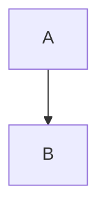

# Trees, titled code, math

```tree
src/
├── app/
│   ├── main.go  # entry
│   └── util.go
├── docs/
│   └── guide/
│       └── intro.md
└── README.md
```

```go title="cmd/server/main.go"
func main() {
	fmt.Println("a fairly long line of code that needs wrapping at narrow width")
}
```

```python
print("plain code")
```

Inline $a^2$ and $5 money.

$$
\sum_{i=1}^{3} x_i^2 = \frac{1}{2}
$$

$$ E = mc^2 $$

```math
x = y
```



> [!DETAILS]
> Untitled details.

| a | b |
|---|---|
| 1 | 2 |

The end.
