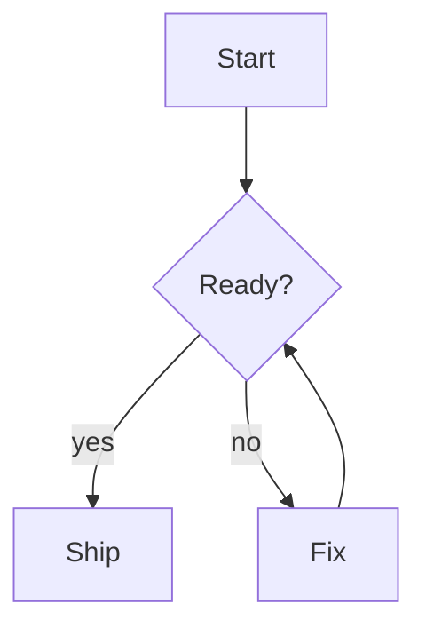
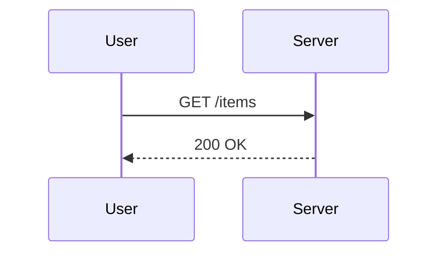
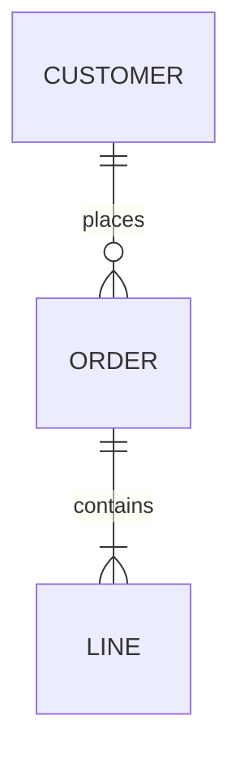
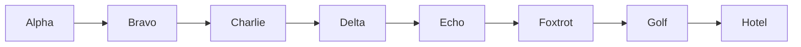
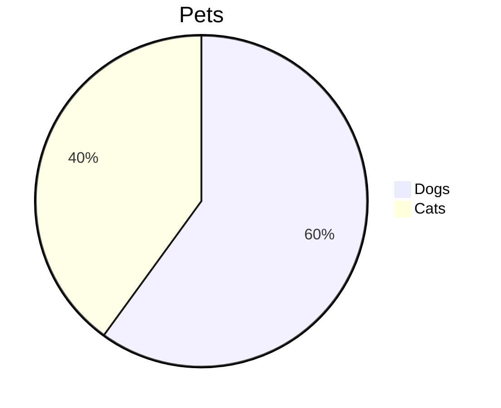

# Diagrams

A flowchart:



A sequence:



An entity relation:



Too wide, shows as code:



A parse error, shows as code:

```mermaid
sequenceDiagram
  A->>
```

Not a type it draws, shows as code:



In a list it stays code:

- Item

  ```mermaid
  graph LR
    A --> B
  ```

The end.
